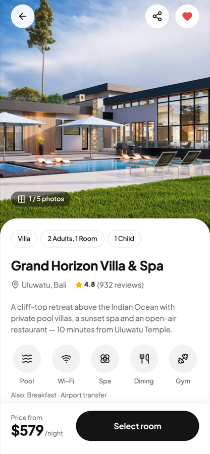
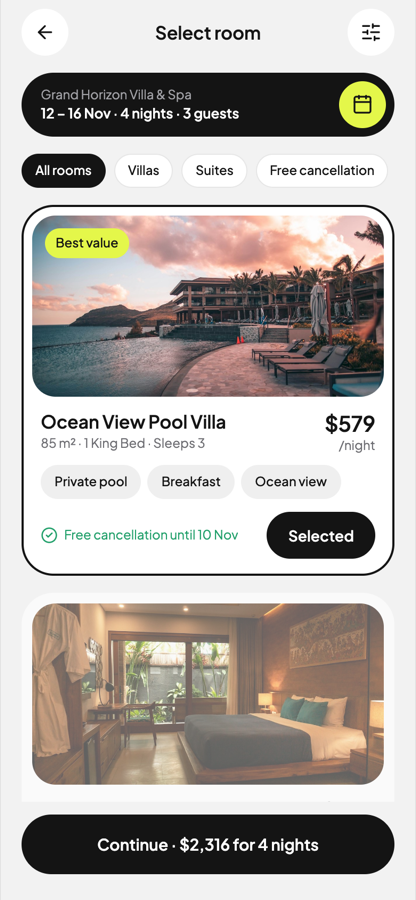
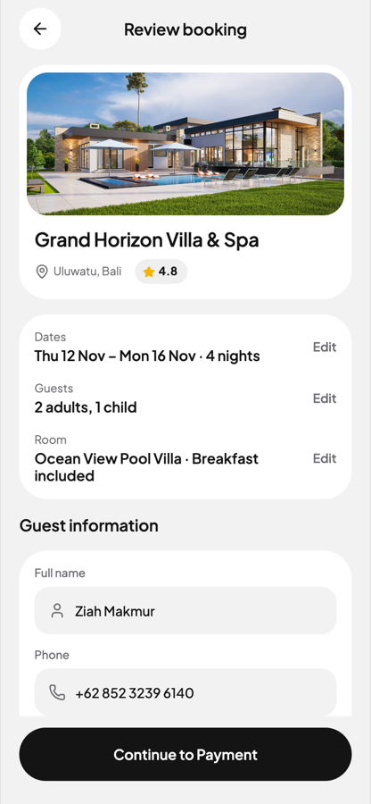
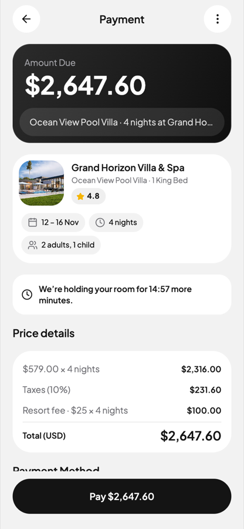
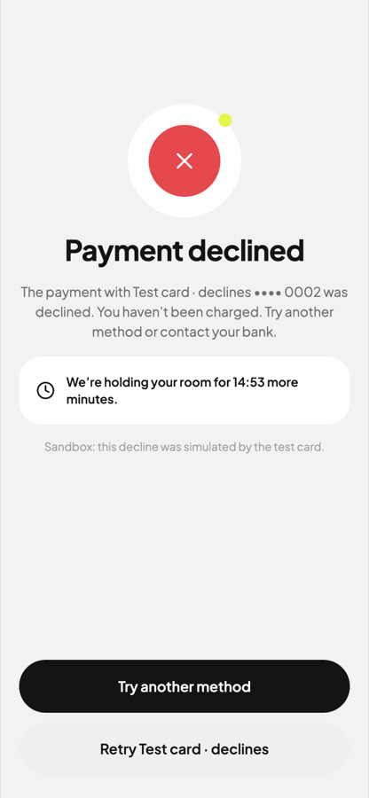
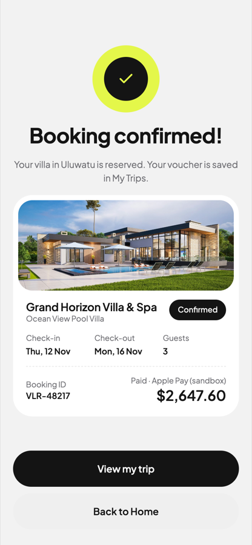
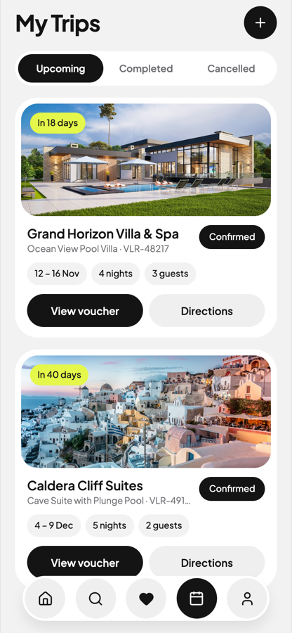
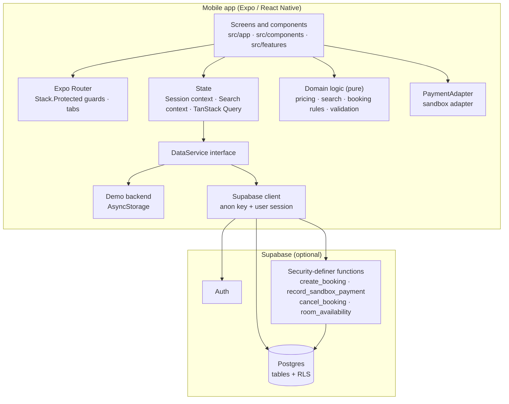
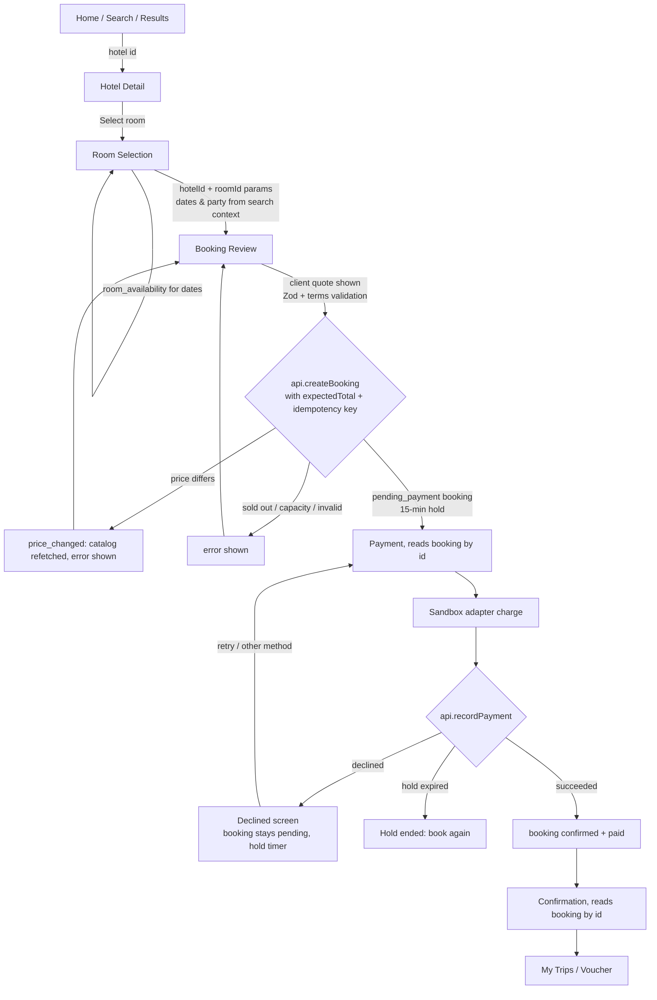
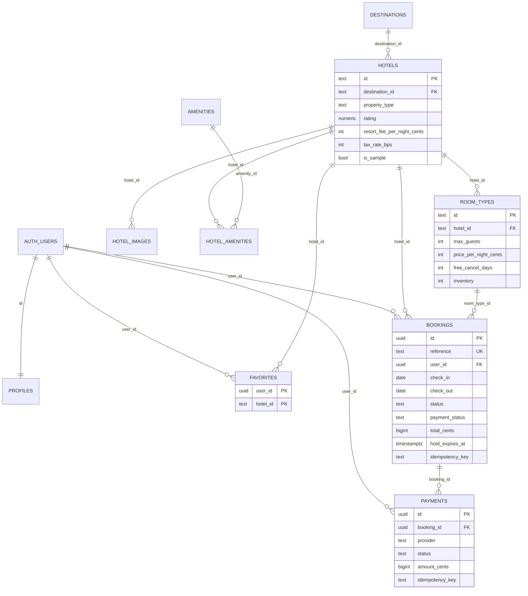

# Velora

Velora is a travel and hotel booking mobile app for iOS and Android. It is built with React Native, Expo, TypeScript and Supabase, from the Velora Figma design ([*ziahdesign → App Velora*, node 262-4229](https://www.figma.com/design/BaGGNADHasoA3oYRZ1L3mv/ziahdesign?node-id=262-4229)).

It covers hotel discovery, room selection, reservations and booking management, through to a **sandbox** payment:

**Home → Hotel Detail → Room Selection → Booking Review → Payment → Booking Confirmation → My Trips**

## Table of contents

1. [Features and status](#features-and-status)
2. [Screenshots and design reference](#screenshots-and-design-reference)
3. [Technology stack](#technology-stack)
4. [Architecture](#architecture)
5. [Project structure](#project-structure)
6. [Application layers](#application-layers)
7. [Core feature workflows](#core-feature-workflows)
8. [Booking and payment data flow](#booking-and-payment-data-flow)
9. [Database and data model](#database-and-data-model)
10. [Authentication, authorization and security](#authentication-authorization-and-security)
11. [API and integrations](#api-and-integrations)
12. [State management and error handling](#state-management-and-error-handling)
13. [Environment configuration](#environment-configuration)
14. [Installation and development](#installation-and-development)
15. [Testing and quality assurance](#testing-and-quality-assurance)
16. [Building for iOS and Android](#building-for-ios-and-android)
17. [Design fidelity](#design-fidelity)
18. [Architecture decisions and limitations](#architecture-decisions-and-limitations)
19. [Roadmap](#roadmap)

---

## Features and status

| Area | Status |
| --- | --- |
| Onboarding (three slides, shown once) | ✅ Implemented |
| Sign up, sign in, sign out, session persistence, change password | ✅ Implemented in both backends |
| Password-reset email and reset link | ⚠️ Supabase backend only; the demo backend can't send email |
| Google and Apple sign-in | 🚧 Buttons only; tapping one says it isn't configured |
| Hotel discovery: destinations, recommendations, "Popular in…" | ✅ Implemented over **sample data** |
| Search, suggestions, recent searches, filters, sorting | ✅ Implemented, filtering on the device |
| Map view of results | ⚠️ Schematic drawing from sample coordinates; no map SDK |
| Hotel detail, amenities, gallery, policies, directions link | ✅ Implemented |
| Dates, guests and rooms selection | ✅ Implemented and validated |
| Room selection with per-date availability | ✅ Implemented (demo inventory) |
| Booking review, priced on the trusted side | ✅ Implemented |
| Payment | ⚠️ **Sandbox only.** No payment provider is connected and no money moves |
| Confirmation, My Trips, voucher, cancellation | ✅ Implemented |
| Favorites ("Saved stays") | ✅ Implemented, per user |
| Profile and settings | ✅ Implemented; language/currency are display-only (English, USD) |
| Reminders (bell on Home) | ⚠️ Derived in the app from your bookings; no push service |
| Flights and Car rental | 🚧 Coming-soon screens; nothing is bookable |
| Supabase backend: schema, RLS, functions, seed | ✅ Written and tested on Postgres (PGlite). ❌ Not yet run against a hosted Supabase project |
| Native iOS and Android run | ❌ Not verified on a device or simulator; the native JS bundles compile |

## Screenshots and design reference

<table>
<tr>
<td></td>
<td></td>
<td></td>
<td></td>
</tr>
<tr>
<td></td>
<td></td>
<td></td>
<td></td>
</tr>
</table>

<sub>Screenshots of the Expo web build at 390 × 844, taken by <code>npm run e2e:web</code>. The design source is the Figma file linked above.</sub>

## Technology stack

Versions come from [`package.json`](package.json).

| Concern | Technology | Version | How Velora uses it |
| --- | --- | --- | --- |
| Mobile framework | React Native + Expo | RN 0.88.0, Expo SDK ~58.0.19, React 19.3.0 | Cross-platform iOS/Android app; web build used for previews and E2E |
| Language | TypeScript (strict) | ~6.0.3 | All app code; `npm run typecheck` |
| Navigation | Expo Router | ~58.0.26 | File-based routes in `src/app`, `Stack.Protected` auth guards, JS tabs with a custom floating nav |
| UI and styling | React Native `StyleSheet` + design tokens | — | No UI kit. Tokens in `src/theme`, components in `src/components` |
| Fonts | `@expo-google-fonts/plus-jakarta-sans` | ^0.4.2 | Plus Jakarta Sans, the Figma typeface |
| Icons | `lucide-react-native` | ^1.61.0 | Lucide 24/2, the design-system icon set |
| Vector graphics | `react-native-svg` | 15.16.0 | Brand mark/wordmark, schematic map, card logos |
| Images | `expo-image` | ~58.0.17 | Cropped photos with fallbacks (`src/components/Photo.tsx`) |
| Gradients | `expo-linear-gradient` | ~58.0.3 | Photo scrims, Amount Due card |
| Server state | TanStack Query | ^5.104.5 | Fetching, caching, optimistic favorites, invalidation |
| Client state | React context + `useState` | — | Session and search criteria; no extra state library |
| Validation | Zod | ^4.6.7 | Form schemas in `src/lib/validation.ts` (forms are plain controlled inputs; no form library) |
| Backend | Supabase (`@supabase/supabase-js`) | ^2.118.0 | Auth, Postgres, RLS and RPC functions, when configured |
| Local persistence | `@react-native-async-storage/async-storage` | 2.2.0 | Demo backend data, Supabase session, search criteria, onboarding flag |
| Crypto / IDs | `expo-crypto` | ~58.0.7 | UUIDs, idempotency keys, demo password hashing (SHA-256) |
| Deep links | `expo-linking` | ~58.0.14 | Password-reset redirect URL (`velora://reset-password`) |
| Testing | Jest + `jest-expo` | ^30.5.2 / ^58.0.12 | Unit and integration tests |
| DB testing | PGlite, pgTAP | ^0.5.11 | Run migration and booking rules on real Postgres |
| Lint | ESLint + `eslint-config-expo` | ^9.39.5 | Includes React Compiler hook rules |
| Builds | EAS Build | config only | [`eas.json`](eas.json) profiles; no build has been run |

**Installed but not imported by app code:**
- `react-native-reanimated`, `react-native-worklets`, `react-native-screens` and `expo-system-ui` are platform/navigation peers from the Expo template.
- `expo-web-browser`, `expo-constants` and `date-fns` are currently unused and could be removed.
- **Not used:** Supabase Storage (all photos are bundled assets or URLs), React Hook Form (not installed), and any payment SDK.

## Architecture

### Overview

Velora is a client-heavy Expo app with a **swappable backend**. Every screen talks to one interface, `DataService` ([`src/data/service.ts`](src/data/service.ts)), which has two implementations:

- **Supabase** ([`src/data/supabase/service.ts`](src/data/supabase/service.ts)): used when `EXPO_PUBLIC_SUPABASE_URL` and `EXPO_PUBLIC_SUPABASE_ANON_KEY` are set. Auth, Postgres tables protected by RLS, and security-definer functions for every booking write.
- **Demo** ([`src/data/local/service.ts`](src/data/local/service.ts)): used otherwise. An on-device backend in AsyncStorage that applies the same rules (pricing, capacity, inventory, holds, idempotency, status transitions), so the app runs with no account or network.

The choice is made once, in [`src/data/index.ts`](src/data/index.ts).

Responsibilities are split between client and trusted side:

- **Client:**
  - UI and navigation;
  - search filtering and sorting over the downloaded catalog;
  - displaying quotes;
  - form validation for fast feedback;
  - running the payment adapter (sandbox).
- **Trusted side (Postgres functions; the demo service plays this role locally):**
  - authoritative pricing;
  - capacity and inventory checks;
  - idempotent booking creation;
  - booking/payment status transitions;
  - ownership checks;
  - cancellation rules.



### How data moves

A user action (for example, "Continue to Payment"):
1. Is validated in the screen with Zod and the pure rules in `src/lib`.
2. Calls a `DataService` method (`api.createBooking`).
3. That method reaches Supabase (an RPC call) or the demo backend.
4. The backend re-checks everything and returns the stored record.
5. The screen writes it into the React Query cache (`useStoreBooking`), so every screen showing that booking updates, then navigates.

## Project structure

```
Velora/
├── app.json                 Expo config: name, icons, splash, scheme "velora", plugins, typed routes, React Compiler
├── eas.json                 EAS Build profiles (development / preview / production)
├── .env.example             Public client configuration placeholders
├── assets/
│   ├── images/              App icon, Android adaptive icon, splash, favicon (rendered from the Figma brand mark)
│   └── photos/              22 bundled JPEGs (Figma file photos + Unsplash) used by the sample catalog
├── docs/screens/            README screenshots
├── scripts/
│   ├── generate-seed-sql.mjs  catalog.json → supabase/seed.sql
│   ├── test-db-pglite.mjs     migration + seed + booking/RLS checks on PGlite
│   ├── e2e-web.mjs            headless-Chrome booking flow on the web build
│   └── cdp.mjs                tiny Chrome DevTools Protocol driver used by e2e-web
├── supabase/
│   ├── config.toml          local CLI config (seed path, auth redirect URLs)
│   ├── migrations/20261025000100_init.sql   schema, triggers, functions, RLS
│   ├── seed.sql             GENERATED sample catalog
│   └── tests/database/booking_rls.test.sql pgTAP tests
└── src/
    ├── app/                 Expo Router routes (see "Navigation layer")
    ├── components/          Design system: Text, Icon, Button/IconButton, Pills, Fields, Photo, Cards,
    │                        Layout, Feedback (Toast, Sheet, states, skeletons), BottomNav, Brand, Avatar, MenuRow
    ├── features/
    │   ├── search/          Calendar, DatesGuestsSheet, FiltersSheet, RangeSlider, SchematicMap
    │   ├── booking/         PriceBreakdown, MethodLogo, useHoldCountdown
    │   ├── favorites/       useFavoriteToggle (optimistic + undo)
    │   ├── home/            RemindersSheet (reminders derived from bookings)
    │   └── categories/      ComingSoon (Flights, Car)
    ├── lib/                 Pure logic: dates, money, pricing, search, booking, validation, format (+ __tests__)
    ├── data/
    │   ├── service.ts       DataService interface, AppError, input/result types
    │   ├── types.ts         Domain types (Hotel, RoomType, Booking, PriceQuote …)
    │   ├── index.ts         Picks the Supabase or demo implementation
    │   ├── photos.ts        Photo keys → bundled assets (or URLs)
    │   ├── seed/            catalog.json (sample data) + typed builder
    │   ├── local/           Demo backend (db.ts seed state, service.ts)
    │   ├── supabase/        client.ts (session storage, PKCE) and service.ts (queries, RPCs, error mapping)
    │   └── __tests__/       Demo-backend integration tests
    ├── payments/adapter.ts  PaymentAdapter interface + sandbox adapter
    ├── state/               session.tsx (auth, providers), search.tsx (persisted criteria), queries.ts (React Query hooks)
    └── theme/               tokens.ts (Figma variables), typography.ts (Figma text styles)
```

## Application layers

### 1. Presentation layer

**Where:** `src/app/**` screens, `src/components`, `src/features`.

- Screens compose design-system components and handle loading (skeletons, `FullScreenLoader`), empty states (`EmptyState`), errors with retry (`ErrorState`), and toasts.
- All colors, radii and text styles come from `src/theme`.
- Cards keep their tap area and inner buttons (for example the heart) as **siblings**, so the web build never nests `<button>` elements.

### 2. Navigation layer

**Where:** `src/app`. The root layout ([`src/app/_layout.tsx`](src/app/_layout.tsx)) loads fonts and providers, then decides which route group the user can reach:

| Guard | Routes |
| --- | --- |
| Signed out, onboarding not seen | `onboarding` |
| Signed out | `sign-in`, `sign-up`, `forgot-password` |
| Signed in | `(app)/…` |
| Always | `reset-password` (opened from the email link) |

Inside `(app)`:
- `(tabs)` holds Home `index`, `search`, `saved`, `trips`, `profile` and `results`. Results is a tab route so the floating nav stays visible; it highlights Search.
- Stack screens:
  - `hotel/[id]`, `hotel/[id]/rooms`;
  - `booking/review`, `booking/payment`, `booking/declined`, `booking/confirmed`;
  - `trip/[id]`, `destination/[id]`;
  - `flights`, `car`;
  - `settings/*` (personal, payments, notifications, language, security, help).

Booking steps pass **IDs only** in route params (`hotelId`, `roomId`, `bookingId`). Dates and party come from the search context, and the booking itself is re-read from the backend.

### 3. Application and domain logic

**Where:** `src/lib`. These are pure functions with no React or I/O, covered by unit tests:

- `pricing.ts`: `quoteStay`, `validateStay`, `fitsParty`, `freeCancelUntil`.
- `search.ts`: `searchHotels`, `fromPriceFor` (party-aware "from" price), `suggestPlaces`.
- `booking.ts`: status transitions, hold expiry (`effectiveStatus`), cancellation policy, My Trips tabs.
- `validation.ts`: Zod schemas.
- `dates.ts`, `money.ts`, `format.ts`.

### 4. State and data-fetching layer

**Where:** `src/state`. See [State management and error handling](#state-management-and-error-handling).

### 5. Data-access layer

**Where:** `src/data`. `DataService` is the only boundary to persistence.
- The Supabase implementation maps rows to domain types, and maps database errors raised as `"<code>: <message>"` into `AppError`s with typed codes (`price_changed`, `unavailable`, `capacity`, `hold_expired`, `network`, …).
- Payment execution is a separate boundary in `src/payments`.

### 6. Backend layer

**Where:** Supabase Auth and the Postgres functions in the migration. The demo backend is the local substitute.
- There is no custom server and no Edge Function.
- Trusted operations are security-definer SQL functions.

### 7. Persistence layer

**Where:**
- Postgres: [`supabase/migrations/20261025000100_init.sql`](supabase/migrations/20261025000100_init.sql).
- Demo mode: one AsyncStorage key (`velora.demo.v1`).

### Known overlaps

- **Rules live in two places.** Business rules are implemented twice: in TypeScript (the demo backend and client checks) and in SQL (Supabase). They are kept in sync by hand and covered by parallel tests (Jest for TypeScript, PGlite/pgTAP for SQL).
- **Search is client-side.** It runs over the full downloaded catalog; this suits the sample catalog size, not a large inventory.
- **No repository layer.** Screens call `api.*` through React Query hooks or directly in submit handlers (review, payment, cancel). There is no separate repository or service layer between them.

## Core feature workflows

| Feature | Screens | Key modules | Data source | Status |
| --- | --- | --- | --- | --- |
| Auth and profile | `sign-in`, `sign-up`, `forgot-password`, `reset-password`, `settings/personal`, `settings/security` | `state/session.tsx`, `api.signIn/signUp/updatePassword/updateProfile` | Supabase Auth + `profiles`, or the demo store | ✅ (reset email: Supabase only) |
| Discovery | Home `index`, `destination/[id]` | `useCatalog`, `searchHotels`, `DestinationCard`, `HotelCard`, `StayRow` | Catalog (sample) | ✅ sample data |
| Search, filters, sort | `search`, `results` | `suggestPlaces`, `FiltersSheet`, `RangeSlider`, `SchematicMap`, search context | Catalog, filtered on the device | ✅ (map is schematic) |
| Hotel detail | `hotel/[id]` | Gallery, amenities, `StayFact`, maps link via `Linking` | Catalog | ✅ |
| Dates, guests, rooms | `DatesGuestsSheet` (Home, Results, Detail, Rooms, Review) | `RangeCalendar`, `validateStay` | Search context | ✅ |
| Room selection | `hotel/[id]/rooms` | `useAvailability`, `fitsParty`, `quoteStay` | `room_availability` RPC or demo inventory | ✅ demo inventory |
| Review and pricing | `booking/review` | `PriceBreakdown`, `guestSchema`, `api.createBooking` | `create_booking` | ✅ |
| Payment | `booking/payment`, `booking/declined` | `payments` (sandbox), `api.recordPayment`, `useHoldCountdown` | `record_sandbox_payment` | ⚠️ sandbox |
| Confirmation and trips | `booking/confirmed`, `trips`, `trip/[id]` | `useBookings`, `tripTab`, `cancellationAllowed`, `api.cancelBooking` | `bookings`, `cancel_booking` | ✅ |
| Favorites | hearts everywhere, `saved` | `useFavoriteToggle`, `useSetFavorite` (optimistic) | `favorites` | ✅ |
| Settings | `profile`, `settings/*` | `useProfile`, `useUpdateProfile` | `profiles` | ✅ (language/currency display-only) |
| Flights / Car | `flights`, `car` | `ComingSoon` | none | 🚧 planned |

## Booking and payment data flow



1. **Carrying the selection.** The hotel and room travel as route params (`hotelId`, `roomId`). Dates, adults, children and rooms live in the persisted search context. Changing dates on any step updates that context, and every screen re-prices.
2. **Showing the total.** `quoteStay` computes subtotal (rate × nights × rooms), tax (the hotel's basis points, rounded half-up to the cent) and resort fees, all in integer cents. The design example gives $2,647.60.
3. **Authoritative price.** `create_booking` recomputes the price in SQL from `room_types` and `hotels`, and rejects the request if the client's `expectedTotalCents` differs. The demo backend does the same in TypeScript.
4. **Creating the booking.**
   - The function locks the room type (`SELECT … FOR UPDATE`) and checks per-night inventory (confirmed bookings plus unexpired holds).
   - It then inserts a `pending_payment` booking with a `VLR-xxxxx` reference and a 15-minute `hold_expires_at`.
5. **Payment outcome.**
   - The sandbox adapter returns `succeeded` or `declined`; the "Test card · declines" method always declines.
   - `record_sandbox_payment` stores a payment row. On success it moves the booking to `confirmed` + `paid`; on decline the booking keeps its hold with `payment_status = failed`.
   - **This outcome is reported by the client and is not proof of payment.** It is only accepted while `app_settings.sandbox_payments_enabled` is true.
6. **Duplicate prevention.**
   - In the UI, an in-flight ref lock plus disabled buttons.
   - Booking creation uses an idempotency key (one per review visit and stay), unique per user in the database.
   - Each payment attempt carries a key that is unique per booking. A booking that is already paid returns unchanged.
7. **Recovery.** The confirmation, payment and voucher screens load the booking by id from the backend, so they work after a restart. Pending bookings appear in My Trips with "Complete payment", and on the Home reminders list.

## Database and data model



`app_settings` (a key/value table with no client policies) holds `sandbox_payments_enabled`.

### Tables

| Table | Purpose and key constraints |
| --- | --- |
| `destinations`, `amenities` | Public catalog lookups |
| `hotels` | Property data, rating, tax rate (basis points), resort fee in cents, `is_sample` flag |
| `hotel_images`, `hotel_amenities` | Composite primary keys `(hotel_id, position)` and `(hotel_id, amenity_id)` |
| `room_types` | Capacity (`max_guests`), price in cents, `free_cancel_days` (null = non-refundable), `inventory` |
| `profiles` | One row per auth user (created by the `handle_new_user` trigger). A guard trigger blocks changes to id, email and currency |
| `favorites` | PK `(user_id, hotel_id)`, which prevents duplicates |
| `bookings` | Price snapshot (nights, rate, subtotal, tax, fees, total, with `total = subtotal + tax + fees` as a CHECK), `check_out > check_in`, unique `reference`, unique `(user_id, idempotency_key)`, partial index on active bookings by room and dates |
| `payments` | Provider (`sandbox` only), status, amount, display label, unique `(booking_id, idempotency_key)`. **No card data** |

**Statuses.**
- `bookings.status`: `pending_payment → confirmed | expired | cancelled`, and `confirmed → cancelled`.
- `payment_status`: `unpaid/failed → paid | failed`, and `paid → voided` (sandbox refunds).
- The `bookings_status_guard` trigger enforces these transitions and forbids edits to the stay or price.

**Migrations and seed.**
- There is one migration file.
- `supabase/seed.sql` is generated from `src/data/seed/catalog.json` by `npm run seed:sql`, so the demo and Supabase catalogs are identical.
- The catalog is **sample data**: 5 destinations, 13 hotels, 21 room types.

**Demo mode** stores the same shapes in AsyncStorage (`src/data/local/db.ts`): users with SHA-256 password hashes, profiles, favorites, bookings and payments.

## Authentication, authorization and security

- **Authentication.**
  - Supabase: email/password via Supabase Auth. Sessions are persisted in AsyncStorage and auto-refreshed while the app is in the foreground.
  - Password reset uses PKCE. The emailed link opens `reset-password`, which calls `exchangeCodeForSession` before `updateUser`.
  - Demo: local accounts. Passwords are stored as SHA-256 hashes, which is acceptable only for on-device demo data.
- **Session handling.**
  - `SessionProvider` listens to `onAuthChange`.
  - When the user changes, all private React Query caches are cleared (the catalog is kept).
  - Route guards hide private routes from signed-out users.
- **Authorization** is enforced by the database, not the UI:
  - RLS is enabled on every table;
  - the catalog is select-only for `anon` and `authenticated`;
  - profiles, favorites, bookings and payments are only visible to their owner (`auth.uid()`);
  - there are no client insert or update policies on bookings or payments, so all writes go through the security-definer functions, which check ownership.
  - `create_booking`, `record_sandbox_payment` and `cancel_booking` are revoked from `anon`.
- **Validation.** Client-side Zod and `validateStay` give fast feedback. The SQL functions re-validate dates, party size, capacity, phone, name and request length, and the price.
- **Secrets.**
  - Only `EXPO_PUBLIC_SUPABASE_URL` and `EXPO_PUBLIC_SUPABASE_ANON_KEY` are read, and both are public by design.
  - No service-role key or payment secret exists in the app.
  - `.env` is git-ignored.
- **Payments.**
  - The app never handles card numbers or CVVs.
  - The sandbox outcome is client-reported, so production must disable `sandbox_payments_enabled` and confirm payments server-side (see [Roadmap](#roadmap)).

## API and integrations

| Integration | Purpose | Configured in | Used by | Required? | Failure handling |
| --- | --- | --- | --- | --- | --- |
| Supabase Auth | Sign up/in/out, sessions, reset email, password change | `src/data/supabase/client.ts`, `.env` | `supabase/service.ts`, `state/session.tsx` | No (demo fallback) | Mapped to `AppError` (`invalid_credentials`, `email_taken`, `auth`) |
| Supabase Postgres (PostgREST) | `select` on catalog tables, `profiles`, `favorites`, `bookings`; `upsert`/`delete` on `favorites`; `update` on `profiles` | same | `supabase/service.ts` | No | `fail()` maps RLS/network errors |
| RPC `room_availability(text[], date, date)` | Units left per room type | migration | Rooms screen | No | Error state + retry |
| RPC `create_booking(...)` | Trusted pricing + pending booking | migration | Review | No | Typed codes shown inline |
| RPC `record_sandbox_payment(...)` | Record sandbox outcome | migration | Payment | No | `hold_expired`, `not_supported` |
| RPC `cancel_booking(uuid)` | Cancel per policy | migration | Voucher, Payment ⋯ menu | No | Toast with message |
| Sandbox payment adapter | Simulated charge | `src/payments/adapter.ts` | Payment | Yes (built in) | Declines route to the declined screen |
| OS maps / share sheet | Directions, share a hotel | `Linking`, `Share` | Hotel detail, Trips, Voucher | No | Toast if no maps app |
| Google / Apple sign-in | — | not configured | Sign-in buttons (show a message) | — | — |

There are no other HTTP APIs. Photos are bundled (`src/data/photos.ts`); a catalog row may also hold an `https://` URL, which `expo-image` loads with a fallback tile.

## State management and error handling

| What | Where | Persists after restart? |
| --- | --- | --- |
| Form fields, sheet visibility, selected room, payment method | Component `useState` | No |
| Auth user, onboarding flag | `SessionProvider` | Session: yes (Supabase/AsyncStorage). Onboarding flag: yes (`velora.onboarded.v1`) |
| Place, dates, party, recent searches | `SearchProvider` (`velora.search.v1`) | Yes, except filters. Stale or invalid dates reset to the default trip |
| Catalog, profile, favorites, bookings, availability | TanStack Query (`src/state/queries.ts`) | In memory only; refetched from the backend |
| Demo backend data | AsyncStorage `velora.demo.v1` | Yes (device only) |

- **Caching.**
  - Catalog: stale after 10 minutes.
  - Availability: 15 seconds.
  - Everything else: 60 seconds.
- **Retries.** Up to 2, except for `auth`, `not_found` and `forbidden` errors.
- **Invalidation and updates.**
  - Favorites update optimistically and roll back on error.
  - `useStoreBooking` writes returned bookings into the list and detail caches and invalidates availability.
  - A `price_changed` error refetches the catalog.
  - Pull-to-refresh on Home, Trips and Saved.
- **UI states.**
  - Skeleton cards while loading.
  - `EmptyState` for no results, trips or saved stays.
  - `ErrorState` with "Try again".
  - Inline field errors.
  - Ink toasts with optional "Undo".
- `errorMessage()` only shows `AppError` messages; anything unexpected becomes a generic message.

## Environment configuration

[`.env.example`](.env.example):

```
EXPO_PUBLIC_SUPABASE_URL=
EXPO_PUBLIC_SUPABASE_ANON_KEY=
```

Leave both empty to use the demo backend.

**Supabase setup:**

1. Create a project.
2. Apply the schema and sample seed:
   ```bash
   supabase link --project-ref <ref>
   supabase db push
   psql "$SUPABASE_DB_URL" -f supabase/seed.sql   # or paste seed.sql into the SQL editor
   ```
3. Copy `.env.example` to `.env` and fill in the URL and **anon** key.
4. In Auth → URL configuration, add `velora://reset-password` (plus your web origin's `/reset-password`) as a redirect URL.
5. Restart `npm start`. The Profile badge changes from "Demo" to "Member".

**For production:**
- run `update public.app_settings set value = 'false' where key = 'sandbox_payments_enabled';`
- integrate a real payment provider.

## Installation and development

**Requirements:**
- Node.js 22 or later (developed on 24.16.0) and npm 11.
- Expo Go for **SDK 58**, or a development build, to run on a device.
- Xcode (iOS Simulator) and/or Android Studio, for local native runs.

```bash
npm install
npm start          # press i / a, or scan the QR code with Expo Go
npm run web        # browser preview
```

**Demo account:** `ziah@velora.travel` / `velora2026`. On the sign-in screen, tap the demo note to fill it in. The account starts with saved stays, one upcoming trip and one past trip. New accounts start empty.

## Testing and quality assurance

| Command | What it covers | Last result |
| --- | --- | --- |
| `npm run typecheck` | `tsc --noEmit`, strict | ✅ passing |
| `npm run lint` | `expo lint`, including React Compiler hook rules | ✅ 0 problems |
| `npm test` | **46 Jest tests.** Unit: dates, money, pricing (incl. the $2,647.60 example), stay validation, search/filter/sort, booking and payment transitions, cancellation policy, Zod schemas. Integration: the demo backend (auth, pricing mismatch, idempotency, capacity, inventory and hold expiry, declined → paid, duplicate payments, cancellation, favorites dedupe, user isolation, restart persistence) | ✅ 46/46 |
| `npm run test:db:local` | The real migration + seed on **PGlite** with a stand-in `auth` schema: 33 checks on pricing, RLS isolation, direct-write denial, idempotency, capacity, inventory, hold expiry, sandbox payments, cancellation, favorites | ✅ 33/33 |
| `npm run test:db` | The pgTAP suite via the Supabase CLI (needs Docker) | ❌ not run here |
| `npm run e2e:web` | Headless Chrome on `npm run web -- --port 8092`: onboarding → sign-in → Home → Detail → Rooms → Review (incl. validation) → declined payment → paid → Confirmed → Trips after reload → Voucher. Screenshots go to `e2e-screens/` | ✅ 12/12 steps |
| `npx expo-doctor` | Expo config and dependency health | ✅ 20/20 |
| `npx expo export --platform ios --platform android` | Compiles the native Hermes bundles | ✅ compiled |

**Not covered yet:**
- UI component tests;
- a native run on a device or simulator;
- the app against a hosted Supabase project (including the Supabase service mapping in `src/data/supabase/service.ts`);
- the password-reset deep link.

There is no Prettier or formatter config; formatting follows ESLint only.

## Building for iOS and Android

[`eas.json`](eas.json) defines three profiles:
- `development`: iOS simulator build, Android APK;
- `preview`: internal distribution, APK on Android;
- `production`: auto-incremented builds.

```bash
npx eas build --profile preview --platform ios       # or android (needs an Expo account)
npx expo run:ios                                     # local build, needs Xcode
npx expo run:android                                 # local build, needs Android Studio
```

The app IDs are `travel.velora.app` (iOS and Android) and the URL scheme is `velora`. **No EAS or native build has been run yet.**

## Design fidelity

Screens were built from the Figma frames' measured values:
- the "Velora/*" Plus Jakarta Sans text styles;
- colors from the Velora variables (`#F2F2F2`, `#FFFFFF`, `#141414`, `#E4F74A`, …);
- 20px margins and 22px section gaps;
- 24/30/32px radii;
- Lucide icons.

The main screens were compared side by side with their frames.

Intentional differences:
- **Avatar:** initials, not a stock photo.
- **Profile badge:** "Demo"/"Member" instead of "Gold"; there is no loyalty programme.
- **Sparkles "AI planner" button:** says the planner is coming soon.
- **Home bell:** shows reminders derived from the user's bookings.
- **Destination screen:** no temperature pill. Stay counts and prices are computed from the data.
- **Booking confirmation:** doesn't claim an email was sent.
- **Map:** schematic.
- **Flights and Car:** coming-soon screens.
- **Web build:** content starts higher than in the frames, because the web has no status bar.

## Architecture decisions and limitations

**Implemented:**
- the `DataService` boundary with two backends;
- trusted SQL pricing and booking functions;
- RLS on every table;
- integer-cent money;
- 15-minute holds;
- idempotency keys;
- status-transition triggers;
- optimistic favorites;
- persisted search criteria;
- bundled offline photos.

**Partially implemented:**
- Supabase mode is written and its SQL tested, but the app hasn't been run against a hosted project.
- The map is schematic.
- Reminders show only inside the app.
- Language and currency settings are display-only.

**Development-only or mocked:**
- the catalog, prices, ratings, reviews and inventory are sample data;
- payments use the sandbox adapter, `record_sandbox_payment` and "voided" refunds;
- the demo backend and its local accounts.

**Planned, not implemented:**
- a real payment provider;
- Flights and Car rental;
- OAuth sign-in;
- push notifications;
- multi-currency;
- server-side search and pagination for a large inventory.

**Technical debt:**
- business rules are duplicated in TypeScript and SQL (mitigated by parallel tests);
- search loads the whole catalog;
- unused dependencies (`date-fns`, `expo-web-browser`, `expo-constants`) can be removed;
- the `Tag` component's `md` size is currently identical to `sm`.

## Roadmap

1. Connect a payment provider with server-side confirmation:
   - an Edge Function creates the PaymentIntent for the stored total;
   - the provider's webhook confirms the booking using the service role;
   - set `sandbox_payments_enabled = false`.
2. Run against a hosted Supabase project; run `supabase test db` in CI.
3. Do native QA on iOS and Android devices; produce EAS preview builds.
4. Move search and pagination server-side when the inventory grows.
5. Add Flights and Car rental once inventory sources exist.
